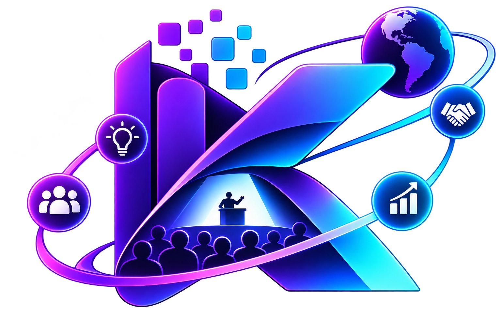

#  🌐 KNET — Knowledge Network & Event Technology

Welcome to the official GitHub Organization for **KNET**, our knowledge and technology network for reinventing event experiences. We represent [Accenture](https://accenture.com/), combining software engineering, infrastructure and human-centered innovation to create memorable experiences for corporate Summits.

We're exploring how technology, data and artificial intelligence can transform the way attendees discover, interact, participate and build connections before, during and after an event. Our mission: *"Convert every event into lasting knowledge, meaningful connections and concrete action."*

---

### 👥 El Equipo

Three Accenture engineers combining custom software engineering, infrastructure and service management to build the next generation of event experiences.

| Avatar | Member | GitHub | Role |
| :---: | :--- | :--- | :--- |
|  | **Andersson David Sánchez Méndez** | [@AnderssonProgramming](https://github.com/AnderssonProgramming) | Custom Software Engineering New Associate |
|  | **Katheryn Sofia Guasca Chavarro** | [@Killerzeus666](https://github.com/Killerzeus666) | Infra Managed Service New Associate |
|  | **Paola de Jesús Barros Claro** | [@pbclaro96](https://github.com/pbclaro96) | Infra Managed Service New Associate |

---

### 🚀 KNET Project Core

Our approach is designed to solve one of the biggest challenges of corporate events: the loss of knowledge, connections and opportunities once the Summit ends.

* **Personalized experiences:** We transform a general agenda into a relevant journey based on each attendee's role, industry, interests, goals and preferred speakers.
* **Intelligent networking:** We help attendees discover meaningful connections among clients, leaders, experts, speakers and partners with complementary interests.
* **Interactive content:** Presentations continue beyond the stage through questions, summaries, explanations, recommendations and connections between sessions.
* **Physical + digital experiences:** We connect the physical Summit with meaningful digital interactions through QR codes, NFC, kiosks, mobile experiences, interactive screens and conversational AI.
* **Audience participation:** We turn opinions, questions, ideas, reactions, votes and conversations into useful insights during the event.
* **Event continuity:** We extend the journey from **Event → Insight → Connection → Action**, keeping the value of the Summit alive after it ends.

---

### 🛠️ Tech Stack & Tools

---

### 📊 Project Philosophy

> **"The best innovation is the one that makes people connect, discover and act in ways they could not before."**

We prioritize technology that serves the human experience. KNET is not simply another event application or a digital agenda; it is an experience designed to make every interaction more relevant, every insight more useful and every connection more meaningful.

---

  <i>Accenture · KNET — Knowledge Network & Event Technology</i>

